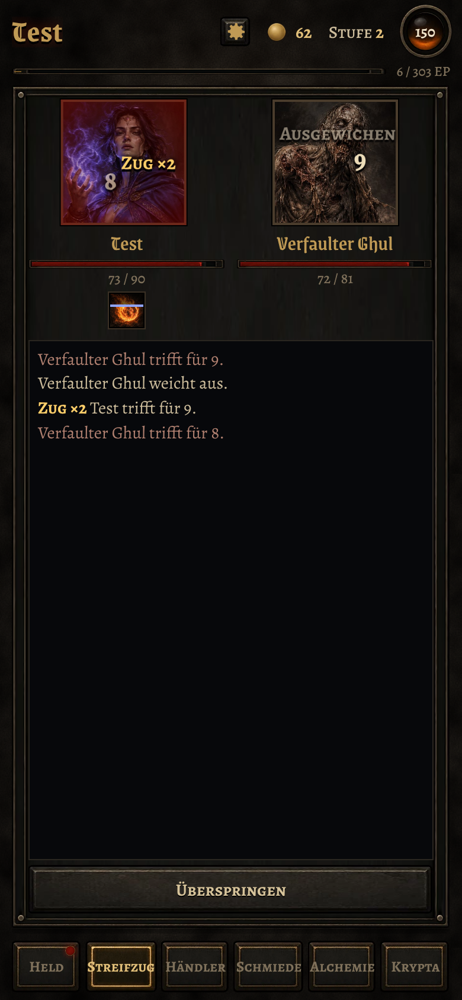
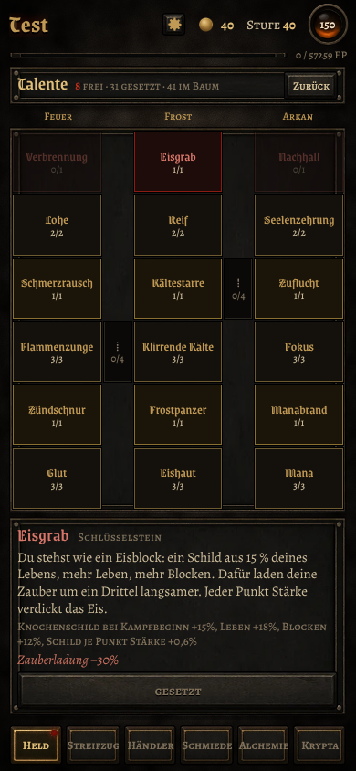
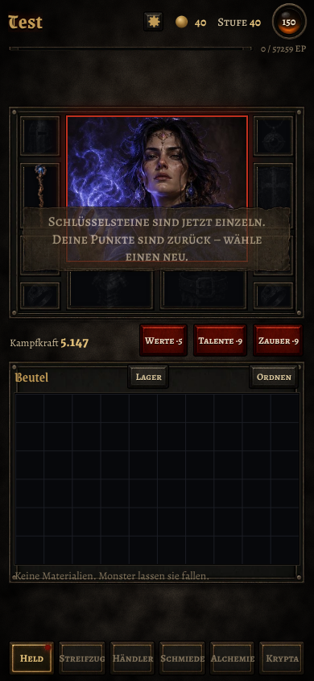

# Umsetzung Kampfsystem (B, Paket, C) – Messbericht 2026-11-22

Branch `claude/kampfsystem-dev` (nicht veröffentlicht). Grundlage: Bericht 3 (`build-umbau.html`) und Bericht 4 (`kampfsystem.html`).
Alle Läufe mit festem Keim, Gegner je Fall neu geeicht, Messkopien unter `/tmp` (Skripte aus `messung-umbau/`, `messung-kampf/`,
die Varianten-Schalter `V.sys` durch `CFG.spellPick` / `CFG.tempoMode` / `CFG.dexHaste` ersetzt).

## Was gebaut ist
| Teil | Schalter | Stand |
|---|---|---|
| B – Zauber nach Lage | `CFG.spellPick` | **an** |
| Paket: ein Schlüsselstein, B3/A5/Z3, Aldemar, Müllerin, 3 Bindungen | – | **an** |
| Glück-Beute L5 | – | **nicht gebaut**, nur gemessen (Bezug 2 × Stufe + 10) |
| C – Zeitachse | `CFG.tempoMode` | gebaut, **aus** |

## Phase 4 – Lagen (reg.mjs, 3 Würfe × 200, 9 Lagen: normal, Elite, 5 Krypta-Bosse, Abgrund T0/T+2)
„Vorn“ = bester oder ≤ 3 Punkte dahinter. **Robust** = nur Lagen, in denen der Beste ≥ 10 % schafft (im Abgrund St. 40 stehen
fast alle bei 0–3 % – dort wäre sonst jeder „vorn“).

| Variante | St. 20 Strategien B·A·Z | St. 40 Strategien B·A·Z | St. 40 Koloss vorn (B / A / Z) |
|---|---|---|---|
| heute | 1·2·4 | 1·2·1 | 8/8 · 8/8 · 9/9 |
| nur B | 1·2·4 | 4·1·1 | 8/8 · 8/8 · 9/9 |
| nur Paket | 4·3·5 | 4·2·2 | 7/8 · 8/8 · 9/9 |
| **B + Paket (gebaut)** | 4·3·5 | 3·1·3 | 8/8 · 9/9 · 9/9 |
| Paket + C | 2·3·4 | 2·2·2 | 7/8 · 8/8 · 9/9 |
| B + Paket + C | 2·3·5 | 3·3·2 | 7/8 · 8/8 · 9/9 |
| … + Geschick→Tempo 0,3 % | 4·4·5 | 4·2·2 | 7/8 · 7/9 · 9/9 |

„B + C ohne Paket“ ist nicht gemessen (C ist auf dem Paket gebaut); Bericht 4 hat es im Prototyp gemessen.
Rauschen: zwischen benachbarten Varianten springen die Zählungen um 1–2 (eine Lage um 1 Punkt über/unter der 3-Punkte-Kante).

## Kriterien
- **≥ 4 Strategien je Klasse auf St. 40: nicht erfüllt** in keiner Variante (am nächsten: Barbar 4 in Paket/nur B).
- **Zauberin nicht auf 2 fallen:** B + Paket 3, mit C 2 → **C verletzt das Kriterium**.
- **Koloss ≤ 6/9: nicht erfüllt** (überall 7–9).
- **Konstitutions-Optimum** (marg.mjs, 3 × 300, St. 20/40): B+Paket 60–70 % (A) / 70 % (B, Z); mit C Assassine 50–60 %, sonst 70 %.
- **Offensive Werte über Kill-Zeit** (sys.mjs, 3 × 400): +20 % Schaden → Kill −5 bis −13 % (alle Varianten); +0,2 Tempo:
  ohne C −2 bis −10 %, mit C −7 bis −15 %. Geschick→Tempo 0,3 % (mit C): +30 Geschick auf St. 40 bringt Barbar 4,4 → 7,4
  (normal) / 0,3 → 8,2 (Boss), Zauberin −0,1 → 4,9 / 5,0 – rund 40 % des Konstitutions-Werts; Assassine kaum (6,2 → 7,3).
- **Stärke gegen heute geeichte Gegner:** B −4…+3 · C +6…+24 (Zauberin St. 40 51 → 71, Barbar St. 20 48 → 72).
- **Progression** (Bot 3 Tage × 2 Läufe): B+Paket wie vorher (Akt VI St. 17–19, Rekord T13–14); mit C Akt VI 1–2 Stufen
  früher, Rekord T17–18 → **leichter ohne Neueichung**.
- **Technik:** voller `sh tests/run.sh` grün (Logik 122, Bot, Fuzz 9000 Züge, alle Balance-Prüfungen, UI, UI-Fuzz); Spielstände
  ohne neues Format (`fixKeystones` beim Laden, Logik-Test); 50-Aktionen-Grenze auch auf der Zeitachse (Logik-Test);
  Kampf mit `tempoMode` aus Wurf für Wurf identisch; Beute unverändert (L5 nicht eingeschaltet).

## Phase 5 – Entscheidung
**`CFG.tempoMode` bleibt aus.** C erhöht die Build-Vielfalt nicht (St. 40 Zauberin 3 → 2, Barbar 3, Assassine im Rauschen),
lässt den Koloss vorn und macht Helden ohne Neueichung bis +24 Punkte stärker (Bot: Abgrund 4–5 Tiefen weiter).
Nächster Schritt laut Auftrag vor einem neuen Anlauf für C: Gegnermechaniken, defensive Synergien und das Verhältnis
Schaden/Leben (ein Held stirbt in 3–5 Gegnertreffern) untersuchen.

## Offen / wartet auf den Besitzer
1. **Glück-Beute L5** mit Bezug 2 × Stufe + 10 (loot5.mjs, 100 000 Teile je Fall; farm.mjs 3 × 120 Abstiege): Frühspiel bei
   typischem Glück neutral (St. 5 selten 12,4 → 12,9 %, St. 10 12,7 → 12,8 %; fester Bezug 90: 9,6 / 10,2 %), Ø-Seltenheit gleich
   (keine Inflation). Wenig Glück (halbes typisches) etwas weniger (St. 10 11,9 → 11,1 %). Abgrund: „Glück statt Hauptattribut“
   +38–55 % legendär heim (Zauberin 0,185 → 0,256), Standard-Build −3 bis −7 %. **Einschalten?**
2. `power()` wählt bei Zauberin (Verbrennung statt Eisgrab) und Barbar (Ahnenruf statt Unsterblich auf St. 20) nicht den gemessen
   stärksten Stein – Grundursache: Kampfkraft unterschätzt Abwehr (Bericht 2). Lösung „ehrliche Kampfkraft“ ist ein eigener Schritt.
3. „Erste Neuwahl kostenlos“ ist über die Punkte-Erstattung gelöst; ein eigener Knopf „Stein ablegen“ ist nicht gebaut.

